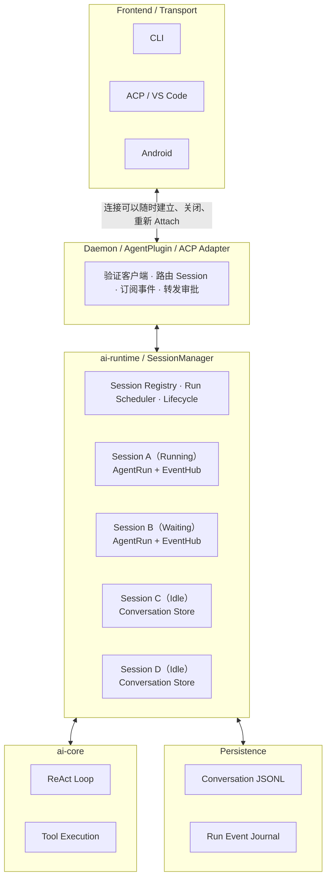
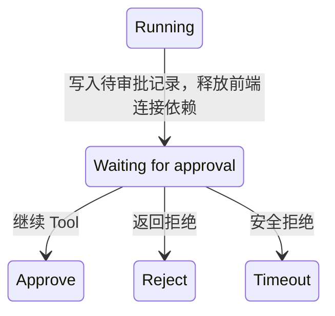

# goworker 多 Session + 后台 Agent + Re-Attach 完整改造 Plan

> 2026-10-26 从 ChatGPT 分享链接提取,基于当时 master 分支实现核对。

> 推荐架构：Session Runtime + Run Supervisor + Event Journal

这次重新核对了 `master` 分支的实际实现，发现有一个比之前更重要的问题：**当前 goworker 不仅是单 Session 模型，而且 Agent 的执行控制权与前端连接存在较强耦合。**

因此，要实现你期望的完整模型，不能只将 `AgentPlugin.session` 换成 `map[string]*Session`。

我的建议是：

**保留现有 `ai-core` ReAct 引擎、`ai-runtime.Session` 和 JSONL Conversation Store，在 `ai-runtime` 增加独立的 Session 运行时，并让 Daemon/ACP 只负责连接与会话路由。**

最终支持：

- 多个 Session 同时执行各自的 Agent Loop。
- 用户离开 CLI、Android 页面或 ACP 连接断开后，Agent 可以继续执行。
- 新连接通过 SessionID 重新 Attach，补齐之前的输出，再接收实时事件。
- 同一个 Session 支持多个观察者，但同一时间只有一个 AgentRun。
- 后台 Agent 遇到 HITL、设备工具不可用等情况能够安全等待或失败，不会错误操作另一个 Session。
- Daemon 重启后恢复历史与运行状态记录，但不盲目重新执行可能产生副作用的工具。

---

## 一、重新核对代码后的关键发现

### 1. AgentPlugin 是当前最大的单 Session 绑定点

实际代码：[daemon/internal/plugins/agent/plugin.go](https://github.com/HTMLgtMK/goworker/blob/master/daemon/internal/plugins/agent/plugin.go)

当前有以下字段：

```go
type AgentPlugin struct {
    runGate chan struct{}

    deps    runtimeagent.SessionDeps
    session atomic.Pointer[runtimeagent.Session]
    store   atomic.Pointer[session.Store]

    mu sync.Mutex

    sessionCwd string
    cwdErr     error

    activeTransportSession string
}
```

这里存在四个关键约束：

| 现有设计 | 造成的问题 | 改造方向 |
|---|---|---|
| `runGate`，容量为 1 | 所有 Session 的 Run 被全局串行化 | 改成按 Session 独占 + 全局并发限额 |
| `atomic.Pointer[Session]` | 只能持有一个当前 Session | 改由 SessionManager 管理多个实例 |
| `atomic.Pointer[Store]` | 一个全局活动 Store | 每个 Session 独立 Store |
| `activeTransportSession` | 后来的连接会顶掉先前连接 | 改成连接与 Session 多对多的订阅关系 |

特别要注意 `AgentPlugin` 注释中的另一个约束：工具收集期间可能通过 `hub.Eval` 发生嵌套命令调用，因此不能直接扩大现有 `runGate` 的临界区，更不能通过一把锁保护所有命令。

这要求明确区分**执行占用权**和**Session 状态读写锁**。

### 2. ACP 本身也明确写死了单活动会话

[daemon/mobile/PROTOCOL.md](https://github.com/HTMLgtMK/goworker/blob/master/daemon/mobile/PROTOCOL.md) 中，当前的约定是：

- `session/new`、`session/load` 会切换 daemon 当前的活动会话。
- 新连接可以使旧连接的活动 Session 失效。
- `session/prompt` 是等待 Run 结束才响应的阻塞请求。
- `session/cancel` 取消当前 prompt。
- 通过连接侧 `x-device/tools`、`x-device/call` 使用 Android 设备能力。

最后一条特别重要：**如果 Agent 已经在后台运行，但原来的 Android Client 断开，Agent 不能继续假定设备工具仍然可用。**

所以需要额外处理连接级工具与 HITL 的路由。

### 3. 当前 Session.Run 的核心执行逻辑可以复用

现有 `Session.Run()` 仍是：

```text
Build Tools / Middleware
       ↓
New Agent
       ↓
Agent.Run()
       ↓
Stream Tokens
       ↓
Commit Conversation
       ↓
Checkpoint
```

这条链路不需要推倒重写。

但目前 Commit 失败主要通过日志记录，方法仍可能返回 `nil`。在加入后台 Run 状态机后，需要区分“模型执行成功”和“对话持久化成功”，否则可能向 Client 报告 Completed，但数据实际上没有保存。

---

## 二、最终目标架构



这里有三层生命周期，必须完全分离。

| 对象 | 生命周期 | 主要终止条件 |
|---|---|---|
| `ClientConnection` | 连接建立到断开 | Socket/ACP/Activity 关闭 |
| `AgentRun` | Start 到完成、取消或失败 | ReAct 结束、显式取消、宿主关闭 |
| `Session` | 创建到显式删除 | 用户删除 Session |

因此：

Disconnect ≠ CancelRun ≠ DeleteSession

这应该作为整个架构的核心不变量。

## 三、Session 和 AgentRun 的数据结构

我建议保持现有 `agent.Session` 名称，但新增一个 `SessionRuntime` 来持有当前运行状态。

### 1. SessionManager

```go
type SessionManager struct {
    mu sync.RWMutex

    sessions map[string]*SessionRuntime
    repo     SessionRepository

    runSlots chan struct{}
    ctx      context.Context
    cancel   context.CancelFunc

    closed bool
}
```

其中：

- `sessions` 仅保存已加载的 Session，不要求所有历史会话常驻内存。
- `repo` 负责创建、加载、列出和删除持久化 Session。
- `runSlots` 作为同时执行 AgentRun 的全局并发上限。
- `ctx` 属于宿主生命周期，不能由任何单个 Client 的连接 Context 代替。

### 2. SessionRuntime

```go
type SessionRuntime struct {
    ID string

    session *agent.Session
    events  *EventHub

    mu      sync.Mutex
    active  *AgentRun
    closing bool
}
```

不要再将 `Agent` 对象长期存入 Session。

其运行态应当是：

```text
SessionRuntime
  ├── Session      （跨轮次）
  ├── EventHub     （跨多个 Run）
  └── active       （当前最多一个）
       └── AgentRun
            └── ai-core.Agent （每轮临时创建）
```

### 3. AgentRun

```go
type RunState string

const (
    RunQueued    RunState = "queued"
    RunRunning   RunState = "running"
    RunWaiting   RunState = "waiting_input"
    RunCompleted RunState = "completed"
    RunFailed    RunState = "failed"
    RunCancelled RunState = "cancelled"
)

type AgentRun struct {
    ID        string
    SessionID string

    mu        sync.RWMutex
    state     RunState
    startedAt time.Time

    cancel context.CancelFunc
    done   chan struct{}

    result RunResult
}
```

这里建议 Run 使用独立 `RunID`，而不是用 SessionID 代表一次执行。

例如：

```text
Session: session_abc
    ├── Run: run_001 → completed
    ├── Run: run_002 → completed
    └── Run: run_003 → running
```

这为后续事件回放、Trace、性能统计、审计以及取消指定 Run 都留好了空间。

## 四、后台运行：谁持有 Agent 的 Context？

这一点决定了后台运行是否真正成立。

### 错误做法

```go
func HandlePrompt(
    ctx context.Context, // ACP 请求 context
    ...
) error {
    return session.Run(ctx, req, callbacks)
}
```

如果 ACP 连接断开，请求 Context 被取消，Agent 也会被取消。

### 推荐做法

运行 Context 由 `SessionManager` 派生：

```go
runCtx, cancel := context.WithCancel(manager.ctx)
```

Frontend 请求只负责创建 Run，不拥有 Run 的生命周期。

```go
func (m *SessionManager) StartRun(
    sessionID string,
    request RunRequest,
) (RunHandle, error)
```

返回的是 `RunHandle`：

```go
type RunHandle struct {
    SessionID string
    RunID     string
}
```

然后 Supervisor 使用独立 goroutine 执行：

```go
func (m *SessionManager) execute(
    ctx context.Context,
    rt *SessionRuntime,
    run *AgentRun,
    req RunRequest,
) {
    // 限流、执行、事件输出、结果落盘、
    // 更新状态、释放运行槽。
}
```

关键约束是：**不允许 Client Connection 的 Context 直接成为 AgentRun 的父 Context。**

### 全局并发控制

建议第一版设置：

```yaml
agent:
  max_concurrent_runs: 4
  max_pending_runs: 16
```

这两个参数是建议的默认值，可以配置，并非仓库现有配置。

同时采用两级控制：

1. 每个 Session 最多一个 active Run。
2. 全局最多 4 个真正进入 ReAct 执行的 Run。

对于等待全局执行槽的请求，我建议使用有界排队。Session 在排队期间已经被占用，不能继续提交第二个 Run。

排队取消必须直接释放占用权，且允许观察者看到 `queued` 事件。

**不建议在 Manager.mu 下等待执行槽，也不建议在锁内调用 LLM、Store、工具或事件订阅回调。**

---

## 五、Re-Attach：不能只依赖 Go Channel

这是整个方案里技术复杂度最高的部分。

原来的 `RunCallbacks.EmitToken` 可以给当前客户端推送 Token，但客户端断开后，新客户端如何取得之前已经输出的内容？

只用：

```go
map[string][]chan Event
```

是不够的。

因为 Subscriber 不在线时，Channel 没有消费方，数据可能丢失；同时，Run 结束后也没有历史事件可读。

所以应该单独增加 `EventHub` 和 `EventJournal`。

### 1. Event 结构

```go
type SessionEvent struct {
    SessionID string          `json:"session_id"`
    RunID     string          `json:"run_id"`
    Seq       uint64          `json:"seq"`
    Type      string          `json:"type"`
    Time      time.Time       `json:"time"`
    Payload   json.RawMessage `json:"payload"`
}
```

`Seq` 是 Session 维度严格递增的游标，不能在不同 Run 之间重复。

建议事件分成两类：

**关键事件（必须持久化）**

- Run started / state changed / finished
- Tool call / tool result
- Permission requested / resolved
- Assistant message finalized
- Error / cancellation

**高频事件（可合并后持久化）**

- Text delta
- Thinking delta
- Token progress
- Usage progress

对于流式文本可以按 50～100ms 或一定字节数合并后落盘；需要低延迟时实时发送增量，但需要保证重放使用相同事件序号语义。最简单的 V1 是先完成一次事件的排序、写入和分发，再向所有 Subscriber 广播。

### 2. EventHub 接口

```go
type EventHub interface {
    Publish(ctx context.Context, ev SessionEvent) error

    Subscribe(
        ctx context.Context,
        fromSeq uint64,
    ) (<-chan SessionEvent, error)

    LatestSeq() uint64
    Close() error
}
```

建议 `Subscribe` 的含义为：

- `fromSeq = 0`：从保留的最早事件开始。
- `fromSeq = N`：返回 `Seq > N` 的事件。
- 如果游标已经落在被清理的历史之前，明确返回 `ErrCursorExpired`。
- 不允许静默跳过缺失事件。

### 3. Re-Attach 的完整流程

1. **客户端断开，Session A 继续执行**：后台持续产生事件（Seq 101 → Seq 102 → Seq 103），Event Journal 已持久化，客户端暂时未订阅。
2. **新连接 Attach，lastSeq = 100**：
   1. **① 注册订阅并确定回放边界**：从 Journal 补齐 101～103。
   2. **② 无缝切到 Live Stream**：接收 104、105、106……
   3. **③ Client 保存已应用的 Seq**：再次断开后继续使用游标恢复。

这里需要重点防范两个 Race Condition：

**Race A：历史回放与实时订阅之间丢事件。**

例如查询历史到 Seq=103，随后才注册 Subscriber，此时 104 已经产生，就可能永久丢失。

解决办法是在 EventHub 内将订阅注册与确定回放边界组合成一个原子逻辑操作。

**Race B：回放和实时流重复或乱序。**

可以给每个 Subscriber 一条独立的发送协程，先输出按 Seq 排序的历史事件，再输出后续 Live 事件。收到重复 Seq 时应去重，但不应忽略真实的缺口。

另外，持久化写入失败不能继续把事件当作可恢复事件正常广播。建议关键事件采用 durable-first 语义。

### 4. Subscriber 必须有背压机制

慢客户端不能影响 Agent 的执行。

建议：

```go
type Subscriber struct {
    ID     string
    Events chan SessionEvent // bounded
}
```

当 Subscriber 队列满时：

- 不阻塞 AgentRun。
- 不阻塞其他 Subscriber。
- 断开该 Subscriber。
- 新连接重新从已确认 Seq 补齐。

这也意味着事件持久化层必须承担短期 Replay 的能力。

不建议永久保留每个 Token 的事件日志。可以在 Run 完成后将高频 Delta 压缩成最终内容记录，并通过快照与保留游标机制支持恢复。

---

## 六、HITL 必须从 Callback 改成独立的决策管理

当前 `Session.Run()` 通过：

```go
RunCallbacks{
    Decide: func(*hitl.InterruptRequest) hitl.Decision,
}
```

同步等待前端决策。

这在单个连接持有整个 Run 时是合理的，但不适合后台执行，因为 Client 可能已经关闭。

建议引入：

```go
type ApprovalManager interface {
    Request(
        ctx context.Context,
        sessionID string,
        runID string,
        request hitl.InterruptRequest,
    ) (hitl.Decision, error)

    Resolve(
        ctx context.Context,
        requestID string,
        decision hitl.Decision,
    ) error
}
```

然后将原有 `Decide` 适配为：

```go
Decide: func(req *hitl.InterruptRequest) hitl.Decision {
    return approvalManager.Wait(runCtx, runID, req)
}
```

这样暂时不需要修改 `ai-core` 的工具执行接口。

### HITL 状态机



这里建议：

- 一个 Pending Approval 有独立 `requestID`。
- 它属于 `SessionID + RunID`，不属于某个 ACP Connection。
- 新 Client Attach 后可以查询并处理尚未过期的 Pending Approval。
- 相同 requestID 只接受一次有效决策。
- 客户端断开后，不再立即取消 AgentRun。
- 超时后默认拒绝，不允许隐式通过。
- 对明显危险的操作，重新 Attach 后仍要有明确的用户确认。

有一点需要强调：对于普通 HITL，可以保持 goroutine 等待决策，不需要立即实现复杂的 Agent 状态序列化。

但如果后续想让等待审批的 Run 在 **Daemon 进程重启后自动继续**，那是另一个级别的能力，需要可恢复的 Agent 执行节点，而不只是保存 Pending Approval。

我建议 V1 不支持自动续跑未完成的工具调用。

## 七、ACP 协议应该如何改？

我建议继续保持标准 ACP 方法兼容，同时增加 goworker 自己的扩展协议。

不要直接改变现有 `session/prompt` 的阻塞响应语义，否则可能影响 VS Code 等现有 ACP 客户端。

### 1. 标准 ACP 方法保留

| 方法 | 建议行为 |
|---|---|
| `session/new` | 创建新 Session，不改变其他 Session |
| `session/load` | 加载指定历史 Session，返回历史 |
| `session/list` | 返回所有可访问 Session |
| `session/prompt` | 保留等待回合完成的兼容语义 |
| `session/cancel` | 取消指定 Session 的活跃 Run |

`session/load` 的作用仍然是加载会话，而不是直接将它变成后台 Run 的事件订阅。

### 2. 新增 goworker 扩展协议

统一采用 `x-goworker/` 前缀：

| 方法 | 参数 | 响应 |
|---|---|---|
| `x-goworker/run/start` | sessionId、input、requestId | runId、state |
| `x-goworker/run/get` | sessionId、runId | state、result、latestSeq |
| `x-goworker/run/cancel` | sessionId、runId | accepted |
| `x-goworker/session/attach` | sessionId、afterSeq | currentRun、latestSeq |
| `x-goworker/session/detach` | sessionId | detached |
| `x-goworker/approval/respond` | requestId、decision | accepted |
| `x-goworker/session/events` | 服务端通知 | SessionEvent |

`requestId` 是客户端提交 Run 的幂等键，与 JSON-RPC 消息 ID 不同。这样连接断开后客户端不知道 Start 是否成功时，重试相同 requestId 不会创建两个 Run。

`run/start` 的响应应该在 Run 被接受并持久化登记后立即返回，不需要等 LLM 完成。

### 3. 协议交互示例

```json
{"jsonrpc":"2.0","id":1,"method":"x-goworker/run/start","params":{"sessionId":"session-A","input":"分析当前项目架构","requestId":"client-req-001"}}

{"jsonrpc":"2.0","id":1,"result":{"runId":"run-001","state":"queued"}}

{"jsonrpc":"2.0","method":"x-goworker/session/events","params":{"sessionId":"session-A","runId":"run-001","seq":1,"type":"run.started","payload":{}}}
```

客户端重连：

```json
{"jsonrpc":"2.0","id":2,"method":"x-goworker/session/attach","params":{"sessionId":"session-A","afterSeq":120}}

{"jsonrpc":"2.0","id":2,"result":{"sessionId":"session-A","currentRun":{"runId":"run-001","state":"running"},"latestSeq":145}}
```

这里 `attach` 的语义必须是原子建立 Replay+Live 订阅。`latestSeq=145` 仅用于描述当前事件位置，不能让客户端直接将已确认游标跳到 145。

客户端只有真正应用了对应事件后，才能推进本地 Cursor。

### 4. 多客户端控制权限

同一个 Session 可以有两个甚至更多 Subscriber，但不是所有 Subscriber 都应该自动有权审批和取消 Run。

建议把能力划分为：

```go
type AttachMode string

const (
    AttachObserve AttachMode = "observe"
    AttachControl AttachMode = "control"
)
```

同一 Session：

- 可以有多个 Observe 客户端。
- 可以有一个 Control Lease 持有者。
- Control Lease 可以过期、主动释放或者被授权接管。
- 权限检查必须在 Daemon 侧完成，不能只依赖前端 UI。

对 Android 和 CLI 这种本机多入口场景，第一版可以采用较简单的宿主授权策略，不必引入完整的用户账号体系。

---

## 八、一个容易忽略的问题：后台 Agent 的工具从哪里来？

这是结合你的现有仓库，我认为必须单独设计的部分。

当前 `RunRequest` 有：

```go
type RunRequest struct {
    Input string

    ToolSource func(
        ctx context.Context,
    ) []core.Tool
}
```

而 Android 的设备工具需要通过客户端 `x-device/*` 调用。

假设：

```text
Android Client A
      ↓
Start Session A Run
      ↓
Agent 读取设备工具 sys_camera
      ↓
Android App 断开
      ↓
Agent 决定调用 sys_camera
```

此时如果工具仍然持有已经关闭的 ACP Conn，就会出错。

更危险的是：如果新 Client B Attach 到 Session A，但没有对应设备能力，不能将工具请求默默路由到 B 的其他设备或宿主。

### 建议新增 ToolCapabilityBinding

```go
type ToolCapabilityBinding struct {
    SessionID    string
    ConnectionID string

    ToolNames []string
    ExpiresAt time.Time
}
```

工具分两种生命周期：

| 工具类型 | 生命周期 | 断开后的行为 |
|---|---|---|
| Host 工具（bash、文件、MCP 等） | Daemon / Plugin | 在授权和宿主存活时可继续执行 |
| Client 工具（Android 设备能力） | Client Connection | 失去连接时不可直接执行 |

对于 Client 工具，我推荐采用 **显式等待重新绑定，且超时安全失败** 的策略：

- 发现原绑定连接不可用时，将 Run 标记为 `waiting_input` 或 `waiting_capability`。
- 等待具备相同工具能力、获得授权的客户端重新 Attach。
- 重新校验能力、设备身份以及工具参数。
- 不允许跨设备静默执行。
- 超过等待期限，则把明确的工具失败结果交给 Agent，由 Agent 决定下一步。

这部分不建议通过简单地更新 `RunRequest.ToolSource` 实现。因为原有 `ToolSource` 只在 Run 开始收集工具时调用一次，而 Agent 运行中工具绑定可能随连接动态变化。

更合适的是注册一个稳定的 Tool Proxy，由 Proxy 在实际执行时解析当前绑定的执行端。

---

## 九、Session Store 与 Run Journal 要分开

建议保留你已有的 Conversation JSONL 树形存储。

但是不要直接把所有实时 Token、连接事件和 Run 状态混入现有的 Conversation JSONL。

因为两者的数据语义不同：

- Conversation Store 负责对话历史、Compact、Checkpoint、Rewind。
- Run Journal 负责执行状态、事件 Replay、断线重连。

目录结构建议改为：

```text
sessions/
├── session-A/
│   ├── current.jsonl
│   ├── metadata.json
│   └── runs/
│       ├── run-001.jsonl
│       └── run-002.jsonl
├── session-B/
│   ├── current.jsonl
│   ├── metadata.json
│   └── runs/
│       └── run-003.jsonl
└── ...
```

`metadata.json` 可以保存：

```go
type SessionMetadata struct {
    ID        string
    Title     string
    CWD       string

    CreatedAt time.Time
    UpdatedAt time.Time
}
```

现有 JSONL Store 已经有不可变的 SessionID 和 CreatedAt 元数据，新增文件应该只保存可变的索引和展示信息，避免形成两个互相冲突的身份事实源。

### Store 接口

```go
type SessionRepository interface {
    Create(ctx context.Context, opts CreateOptions) (
        *SessionRecord, error,
    )

    Open(ctx context.Context, id string) (
        *SessionRecord, error,
    )

    List(ctx context.Context) (
        []SessionMetadata, error,
    )

    Delete(ctx context.Context, id string) error
}
```

建议 Repository 对同一 SessionID 保证唯一的 Store 实例，避免多次 Open 产生不同文件句柄共同写入。

Run Journal 还需要额外保证：

- 单调递增 Seq，包含在磁盘恢复信息中。
- 遇到部分写入的尾记录，有明确的截断修复策略。
- Completed 状态必须在 Conversation Commit 成功之后记录。
- 高频事件可以批量持久化，但重要状态变更需要明确的持久化边界。
- 多进程同时打开同一 Session 时拒绝第二个写者，至少要有文件锁或单实例宿主约束。

### Daemon 重启后怎么处理？

这里需要把“恢复 Session”和“恢复 AgentRun”明确分开：

| 运行前状态 | 重启后的建议行为 |
|---|---|
| Session Idle | 恢复 Conversation，仍然 Idle |
| Run Completed | 恢复历史与结果 |
| Run Running | 标记 Interrupted，不自动重新调用工具 |
| Run Waiting Approval | 恢复审批记录，但旧 Run 标记 Interrupted |
| Run Queued | 可按策略重新排队；V1 建议标记 Interrupted |

这样既满足“重启后能重新 Attach 查看历史与结果”，又不引入危险的自动重复执行。

**后台运行意味着 Client 断开但宿主继续运行，不等于 Daemon/Android 进程被系统杀死后仍可继续运行。**

对于 Android，如果希望 Activity 退出但 Agent 继续执行，Host 需要由比 Activity 更长寿的组件管理，例如应用级 RuntimeService；涉及真正长时间后台执行时，还要遵守 Android 的前台服务和后台执行限制。

## 十、具体代码改造清单

下面是我建议最终落地的文件级 Plan。

**实施任务检查表**

**P0 · 基础重构**

- [ ] 增加 SessionManager、SessionRuntime、AgentRun
- [ ] 移除全局 runGate 的串行执行职责
- [ ] 建立每 Session 独占执行机制
- [ ] 对 Run、Compact、Rewind 建立一致的并发约束

**P1 · 多 Session 持久化**

- [ ] 为每个 Session 创建独立 Store
- [ ] 实现 SessionRepository 的 Create/Open/List/Delete
- [ ] 将 CWD、Usage 等状态与 Session 绑定
- [ ] 处理文件锁、重复 Open、关闭与崩溃恢复

**P2 · 后台执行**

- [ ] 实现 RunSupervisor 与 Manager 生命周期 Context
- [ ] 添加有界全局并发调度
- [ ] StartRun 立即返回 RunHandle
- [ ] 实现 CancelRun、Shutdown、Run 状态持久化

**P3 · 事件回放与 Attach**

- [ ] 定义 SessionEvent 与 Seq 游标
- [ ] 实现 JSONL EventJournal
- [ ] 实现 EventHub Replay + Live 原子切换
- [ ] 处理订阅背压、断线、CursorExpired

**P4 · HITL 与设备工具**

- [ ] 引入 ApprovalManager
- [ ] 实现 Pending Approval 查询与重新审批
- [ ] 引入 Client Tool Proxy 和 CapabilityBinding
- [ ] 添加设备断开、重新绑定、安全超时处理

**P5 · 前端协议**

- [ ] 新增 x-goworker 扩展协议与能力协商
- [ ] 修改 AgentPlugin 单活动会话绑定
- [ ] 支持 CLI/ACP/Android 多 Session 切换
- [ ] 更新 mobile/PROTOCOL.md 和集成测试

### 推荐目录结构

```text
ai-runtime/
├── agent/
│   ├── session.go          # 保留现有 Session
│   ├── manager.go          # 新增：SessionManager
│   ├── runtime.go          # 新增：SessionRuntime
│   ├── run.go              # 新增：AgentRun
│   ├── supervisor.go       # 新增：Run 调度执行
│   ├── event_hub.go        # 新增：事件广播 + Replay
│   ├── approval.go         # 新增：HITL 决策管理
│   └── capability.go       # 新增：工具能力绑定
├── session/
│   ├── store.go            # 现有 Conversation Store
│   ├── repository.go       # 多 Session 仓库
│   └── journal.go          # Run Event Journal
└── ...

daemon/
├── internal/plugins/agent/
│   ├── plugin.go           # 改为持有 Manager
│   └── ...                 # 命令路由改为显式 SessionID
├── internal/core/
│   └── acpworker/          # ACP 服务和工具中继适配
└── mobile/
    └── PROTOCOL.md         # 更新扩展协议
```

### 需要特别注意的改造边界

`AgentPlugin` 中全局可变的 `deps`、`sessionCwd`、`cwdErr`、`activeTransportSession` 不能继续作为多 Session 的共享当前态使用。

应该区分：

- 全局资源：MCP Client、Memory Client、Provider Factory、Skills 清单。
- Session 资源：CWD、Conversation、Store、Usage、工具授权。
- Run 资源：输入、Provider 实例、Middleware、CancelFunc、工具能力快照与事件输出。
- Connection 资源：ACP Conn、Device Tools、订阅 Cursor、Control Lease。

尤其是 `deps.Store`，创建新 Session 时必须绑定相应的 Store，不能继续从一个全局可变 `p.store` 获取。

---

## 十一、Unit Test 与集成测试验收标准

建议这些测试作为每阶段完成的硬性门槛。

| 测试 | 验收标准 |
|---|---|
| `TestConcurrentSessions` | A/B 使用不同 SessionID，同时进入模拟 Provider 执行，互不阻塞 |
| `TestSameSessionBusy` | 同一 Session 的第二个 Run 被拒绝或有界排队，不产生历史覆盖 |
| `TestRunSurvivesDisconnect` | Client Context 取消后，后台 Run 仍可完成 |
| `TestCancelIsolation` | 取消 A 的 Run，B 不受影响 |
| `TestAttachReplayNoGap` | 并发 Publish/Attach 压测下，无事件缺失或乱序 |
| `TestSlowSubscriber` | 慢订阅者被隔离，不阻塞执行 |
| `TestApprovalAfterReconnect` | 原连接断开，新控制端 Attach 后能审批同一 Pending Request |
| `TestToolBindingDisconnect` | Client 设备工具断连后，不会被静默路由到其他设备 |
| `TestRestoreInterruptedRun` | 崩溃重启后历史可读，未完成工具不会自动重放 |
| `TestConcurrentStoreOpen` | 同一个 Session 不会有两个独立写入者 |

Go 代码至少通过：

```bash
go test ./... -race
```

由于仓库采用 `go.work` 多模块结构，建议对所有相关模块分别执行测试，并在 daemon 额外验证移动端使用的 Build Tags。

还要重点增加一个失败注入测试：**Conversation Commit 失败时，不能记录 RunCompleted。**

---

## 十二、推荐的实际开发顺序

我建议先落地 P0～P3，形成完整的多 Session 后台运行闭环，然后再做 P4 的跨连接审批与设备能力恢复。

### 第一阶段：多 Session 执行内核（P0 + P1）

SessionManager + 独立 Store。先保证同时运行互不污染，保持现有单 Session CLI/ACP 路径可用。

### 第二阶段：后台运行与 Re-Attach（P2 + P3）

RunSupervisor + EventJournal。使用模拟 Provider 验证连接断开后继续执行，以及重连无缝补齐事件。

### 第三阶段：跨连接 HITL、ACP、Android（P4 + P5）

保留标准 ACP 兼容行为，新增扩展能力，最后迁移前端并删除不再需要的单活动 Session 逻辑。

我还建议在第一阶段加一个明确的范围限制：**V1 不做多进程 Session 迁移、不做 Agent Loop 指令级持久化，也不允许同一 Session 同时执行多个独立的主 AgentRun。** 这些都是未来可以扩展的功能，但现在引入会明显增加复杂度。

## 十三、最终架构决策

| 设计问题 | 最终建议 |
|---|---|
| SessionManager 所属层 | `ai-runtime/agent` |
| Agent 对象保存方式 | 每次 Run 新建，执行结束释放 |
| 多 Session 并发 | 支持，全局配额控制 |
| 单 Session 并发 | 一个 active Run |
| 后台执行 | Run Context 归 Manager/Supervisor 管理 |
| 多客户端 Attach | 支持，Observe/Control 分离 |
| Re-Attach 数据来源 | EventJournal + Live EventHub |
| Conversation 存储 | 保留现有 JSONL Store |
| 高频事件存储 | 独立 Run Journal，支持合并和压缩 |
| HITL | 独立 ApprovalManager |
| Android Device Tools | 显式 CapabilityBinding + Tool Proxy |
| ACP 兼容 | 保留标准接口，新增 `x-goworker/*` 扩展 |
| Daemon 重启 | 恢复历史和中断状态，不自动重跑有副作用的 Tool |

**整体上，这会把 goworker 从“一个拥有当前 Agent 的 REPL 程序”演进为“一个可以同时托管多个有状态 Agent Session 的 Runtime”。**

这个设计既能支持你现在的 CLI、ACP 和 Android，也为未来的后台 Agent Task、定时执行、远程客户端以及多 Agent 协作保留扩展空间，而不需要进一步增加 AgentPlugin 的特权耦合。

下一步最值得做的是先把 **P0 + P1 转成严格的代码级实施 Plan**，逐个列出当前函数如何改签名、哪些全局字段要移除、`/new` `/agent` `/compact` 如何按 SessionID 路由，以及如何通过兼容适配器保持旧 CLI 行为。这样可以从一个低风险、可测试的 PR 开始，而不是一次性修改整个 ACP 协议。
